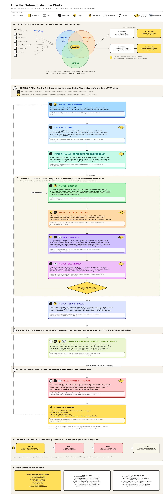

# The Outreach Machine — Human Skills Training

**What this is.** The complete, runnable documentation and code of the cold-outreach system Chris Danilo runs for
[Human Skills Training](https://chrisdanilo.com): two machines (OM-1 training days · OM-2 conference keynote/MC) on one
engine, one Rulebook, one master list. A scheduled AI session (Claude, on a Mac with this folder mounted) follows the
standing orders in `_shared/orchestrator/LAUNCHER-*.md`; the Python programs do every deterministic step; AI helpers do
only judgment (read a web page, judge fit, find people, write the plain-English report). The machine never writes email
copy, never picks recipients on its own, and never sends Email 1 — Chris does.

**Public copy, synced 2026-11-10** from the live folder by `publish/export_public.py`. Take it and run with it: read this page,
then `0_Design-and-Purpose/CHARTER.md` → `RULEBOOK.md` → the two launchers. Replace the templates, fill `settings.json`,
point `paths.py` at your folder.



*(The editable `.excalidraw` and the `.svg` are beside the PNG in `0_Design-and-Purpose/diagrams/`.)*

---

---
business: Human Skills Training
title: Automations — START HERE. The one folder for the outreach system (OM-1 + OM-2), laid out the way the night runs
status: live since 2026-10-31 · one folder since 2026-11-02 · phase layout since 2026-11-03 · Supply Run since 2026-11-08
updated: 2026-11-08
---

# Automations — start here

Read in this order: **0_Design-and-Purpose/CHARTER.md** (why it exists, what it must never become) → **0_Design-and-Purpose/RULEBOOK.md** (the rules) → **0_Design-and-Purpose/VOCABULARY.md** (the words) → this map.

## The shape of the folder

The folders are numbered in the order the night actually runs, so when a step fails you know which folder to open. Every phase folder has the same four drawers:

| Drawer | What is in it |
|---|---|
| `PhasePurpose/` | A one-page README: what this phase does, what goes in and comes out, which Rulebook sections it applies, how to tell it worked, and its CAPAs |
| `programfiles/` | The program(s) for this phase, the prompt the helpers read, the standing orders (`LAUNCHER-<step>.md`), and the tests |
| `ledgers/` | What this phase has decided — kept for good |
| `runs/` | Tonight's working files and page captures — pruned after 3 days by the last step of the night run |

```
Automations/
  README.md                    this map
  0_Design-and-Purpose/        CHARTER · RULEBOOK · VOCABULARY · decisions/rulings.jsonl (the ONE rulings log) · capa/ · diagrams/
  1_Read-the-Inbox/            read every outreach thread in Gmail; label thread state; the review-hold drafts
  2_Discover/                  find new organizations and events (one discovery ledger)
  3_Qualify/                   decide fit, which machine owns an org, and when outreach opens
  4_People/                    find up to 4 people per org and check every address
  5_Draft/                     write the Email 1 drafts (Chris sends them by hand)
  6_Report/                    the one morning report
  7_Send/                      tomorrow's approved send list; the 7 AM send of Emails 2 and 3
  _shared/
    master/                    orgs.jsonl (the master list) · master-list.csv · settings.json (THE one settings file) · overrides.json · build_master.py · seeds/
    machines/OM-1, OM-2        each machine's own data and ledgers (contacted threads, events, territory) — no programs
    orchestrator/              run.py · nightrun.py · supplyrun.py · lock.py · invariants.py · rulings.py · paths.py (the one file that knows every folder) · night/ · supply/ · lock files · version log · the three task launchers
  publish/                     the public copy: export_public.py rebuilds publish/export/ + a dated zip; pushed to github.com/chrisdanilo/outreach-machine (SHARE-PROCEDURE.md)
  archive/                     everything not in use — nothing live reads it, ever
```

## For Chris — I want to… → open

| I want to… | Open |
|---|---|
| See where everything lives, in one picture | `0_Design-and-Purpose/diagrams/2026-11-03-where-everything-lives.png` |
| See how the whole machine runs, in one picture | `0_Design-and-Purpose/diagrams/2026-11-10-how-the-outreach-machine-works.png` (setup → night run → supply run → 7 AM send → Chris; the `.excalidraw` beside it is editable) |
| See what the Supply Run stocked last night | `_shared/orchestrator/supply/runs/supply-<date>/timing.md` (steps, minutes, the shelf table) — the morning report also carries the shelf line |
| Read this morning's report | `6_Report/ledgers/reports/<today>.md` (details beside it: `<today>-details.md`) |
| Review the night's Email 1 drafts before sending | `5_Draft/ledgers/dossiers/dossier-<date>.md` (newest), with Gmail Drafts open |
| See what will send at 7 AM | `7_Send/ledgers/send-lists/<date>.md` |
| Check or change a rule | `0_Design-and-Purpose/RULEBOOK.md` — changes only from you |
| Change a number (minimums, ceilings, labels, holidays, caps) | `_shared/master/settings.json` — the one settings file; each machine is one block under `machines` |
| Answer open questions | the "Open questions" section of `<today>-details.md`; the log is `0_Design-and-Purpose/decisions/rulings.jsonl` |
| Read what went wrong and the fix | `0_Design-and-Purpose/capa/INDEX.md` → the CAPA files · each phase's `PhasePurpose/README.md` lists its own |
| See exactly what the computer is told each night / morning | `_shared/orchestrator/LAUNCHER-night-run.md` · `_shared/orchestrator/LAUNCHER-send.md` |
| See what one step is told | `<phase>/programfiles/LAUNCHER-<step>.md` |
| Look at the master list | `_shared/master/master-list.csv` (a read-only view of `orgs.jsonl`) |
| Understand one phase | `<phase>/PhasePurpose/README.md` |
| Find anything old, superseded or moved | `archive/README.md` · `archive/MOVES-2026-11-03.tsv` (every move of the 11/03 restructure, old → new) · `archive/MOVES-2026-11-02.tsv` |
| Empty the pruned captures | `archive/pruned/<date>/` — the night run moves old working files there (the vault shell cannot delete); delete the folder yourself when you like |

## For the computer — what is read at run time

| Reader | Reads |
|---|---|
| Scheduled task **Outreach Night Run** (Sun–Thu 8:41 PM MT) | `_shared/orchestrator/run.py night` → prints `_shared/orchestrator/LAUNCHER-night-run.md` |
| Scheduled task **Outreach Send (approved list only)** (Mon–Fri 6:52 AM ET) | `_shared/orchestrator/run.py send` → prints `_shared/orchestrator/LAUNCHER-send.md` |
| Scheduled task **Outreach Supply Run** (every day ~1 AM MT; Chris 2026-11-08) | `_shared/orchestrator/run.py supply` → prints `_shared/orchestrator/LAUNCHER-supply.md`; sequenced by `supplyrun.py` (discover → qualify → events → people → shelf; never drafts, never touches Gmail; hard stop 4:30 AM) |
| Every program | `_shared/orchestrator/paths.py` (where everything is) · `_shared/master/settings.json` (every number) · `_shared/master/orgs.jsonl` (the master list) · `_shared/master/overrides.json` (your data rulings) |
| Each phase | its own `ledgers/` and `runs/`; the machine data under `_shared/machines/` |
| Email copy | `5_Draft/programfiles/templates/Cold-Outreach-Sequence-CCR&R.md` (OM-1) · `…-Conference.md` (OM-2) — frozen copy, Rulebook C6 |
| Shared lists outside this folder | `../do-not-contact/register.jsonl` · `../Lists/…/HS_Grantees_by_Size_2026-10-23.csv` |
| Locks and checkpoints | `_shared/orchestrator/.outreach-lock` (night AND supply — they take turns, never overlap) · `.outreach-send-lock` (send) · `night/current.json` · `supply/current.json` · `supply/shelf-latest.json` (what the supply run left for the night) |

## Vocabulary
**The Supply Run** (2026-11-08) = the 1 AM task that stocks the shelf. **The shelf** = what the night run finds ready when it starts: organizations ready to draft (fit, open, people found, never emailed), fit-and-open organizations whose people are still to be found, and found-but-unqualified organizations. **Engine / the system** = this folder. **OM-1** (Machine 1, CCR&R / training) and **OM-2** (Machine 2, conferences) are **machines** — never "lanes", never "pipelines". Full list: `0_Design-and-Purpose/VOCABULARY.md`.

## Open items (2026-11-08)
0. Event-certainty step (Supply Run step 3) waits for Chris's ruling on the trigger list (proposed 2026-11-08 in chat; logged as an open ruling). Until then it is skipped each run and says so.
1. CAPA 2026-10-31 — permissions for unattended runs (M1-R011): still unresolved. The 7 AM send has sent 0 rows on 11/02 and 11/03.
2. ~~Stage 10: regenerate the GitHub copy~~ — done 2026-11-10: `publish/export_public.py` rewritten for this layout; repo synced; Notion retired.
3. Rebuild into the night run: dossier step · reply-timing capture (K3) · weekly HubSpot cleanup · bulk label backfill.
4. The two sender programs (`7_Send/programfiles/send.py` plans; `followup_send.py` sends) — build decision deferred.

## Read by things outside this folder

| Reader | Reads (read only) | If you move or reshape it |
|---|---|---|
| TLP practice dashboard (`3.Human Skills Training/TLP/bin/funnel_conversion.py`, run by `TLP/bin/tlp_refresh.py`) | `_shared/master/orgs.jsonl` — every Machine 1 thread's sends (`threads[].messages_sent`, `gmail.bounced`, `stage`) for the outreach funnel; `_shared/machines/OM-1/contacted.jsonl` for history only | The dashboard finds both files by name wherever they sit (never in `archive/`), and stops with PROBLEM if it finds none or two. Keep one live copy of each, and keep the fields above, or update that script in the same change. Added 2026-11-05 at Chris's request after the 11/02 and 11/03 restructures broke the dashboard's funnel |

---
*Public copy, generated 2026-11-10 by `publish/export_public.py`: people's names, personal email addresses (now `personNNNN@theirorg.org`), phone numbers, existing-client organizations, Gmail message/thread ids and credentials are redacted; organization names, prospect criteria, templates and method are untouched. The 30+ CAPA case files are summarized in `0_Design-and-Purpose/capa/INDEX.md` and not included (they quote prospect pages). Ledgers and run folders are never included.*
